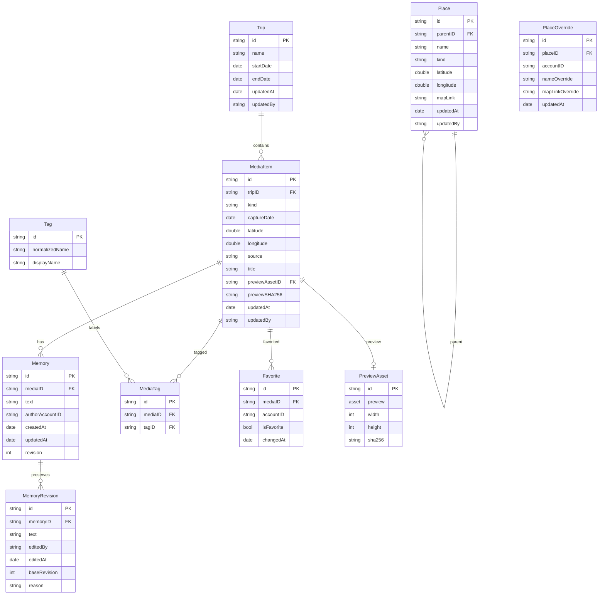
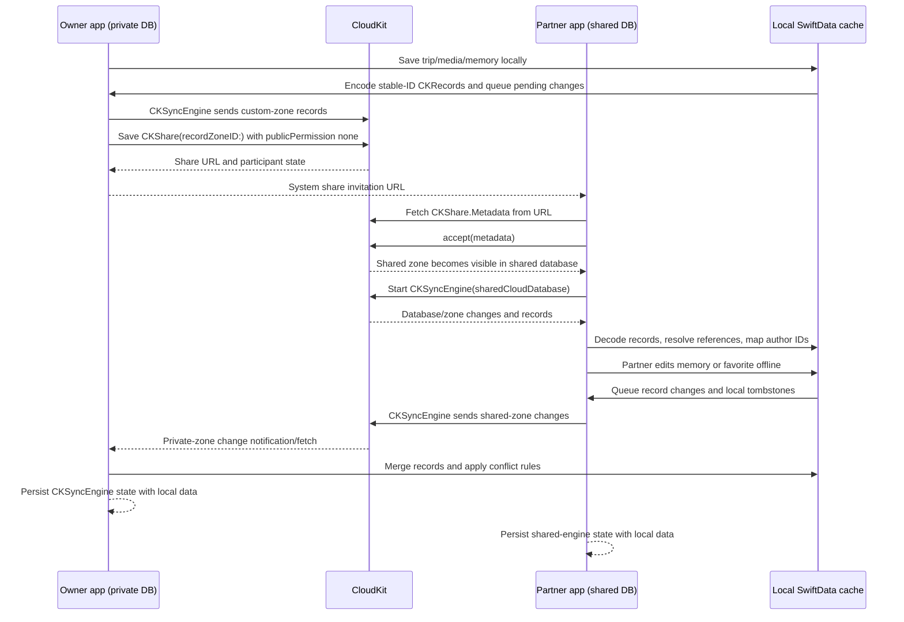

# Moments sharing architecture (issue #14)

## Decision

Use SwiftData as the local cache and UI model, with a small CloudKit adapter built around **`CKSyncEngine`**. The owner creates one custom, zone-wide share in the owner's private database. Custom zones are created only in the private database; after acceptance CloudKit exposes the zone to the participant through the participant's shared database. The invited person accepts the `CKShare.Metadata` invitation and syncs the resulting zone through the shared database. Keep a separate sync-engine state file for each account and database scope.

`NSPersistentCloudKitContainer` with `CKShare` is a viable alternative, and it is Apple's documented sharing path: since macOS 12 the container accepts share invitations into a second persistent store whose `databaseScope` is `.shared` (Apple's "Sharing Core Data objects between iCloud users" sample does exactly this). Note that the `databaseScope` comment in `NSPersistentCloudKitContainerOptions.h` still says only private and public are supported; that comment predates the macOS 12 sharing APIs and is not a reason to reject the route.

We still recommend `CKSyncEngine`, for three reasons:

1. **Memories must never be silently lost.** The Core Data mirror resolves concurrent edits record by record (effectively last writer wins) and gives the app no hook to keep the losing text. Two people editing the same memory offline is a normal case for this app, so we want explicit `serverRecordChanged` handling that keeps both texts.
2. **No second model layer.** Every screen already reads SwiftData. The Core Data route means rewriting the model in Core Data (two stores: private plus shared) and bridging it into SwiftUI, before any sharing code is written.
3. **Control over what syncs.** Per-person favorites and place overrides, previews only as small assets, and no sync of local file identifiers are easier to guarantee when the app encodes each record itself.

The cost is real: the app owns the record encoding, the pending-change queue and the engine state. If that cost turns out too high, Core Data sharing is the fallback, not a dead end.

This is a two-person private share: `publicPermission` remains `.none`, the owner adds one private participant with read-write permission, and the app never uses the public database or a third-party service. Use the placeholder container `iCloud.org.example.Moments` in examples and configuration until a team assigns the real container identifier.

## Current model and target model

The current SwiftData model is a useful local starting point but is not a CloudKit record schema:

- `MediaItem`, `Place`, `Trip`, and `Tag` use `@Attribute(.unique)`.
- `Memory` has no explicit ID, so its identity is currently the SwiftData object identity.
- `MediaItem.isFavorite` is one shared Boolean, although favorites need to be per person.
- Relationships are object references; CloudKit sync records need stable IDs and explicit references.
- The current default store remains local at the app-support location. It must not be replaced in place until export and verification finish.

The target SwiftData cache removes `.unique` and stores ordinary stable string IDs. The sync adapter maps those IDs to `CKRecord.ID(recordName:zoneID:)`; it never uses a random record name on each upload.



`PlaceOverride` is shown because the UI needs a personal override without repeatedly overwriting shared canonical place data. It can be a separate record type even if the first local implementation materializes it as a derived SwiftData type.

### CloudKit records and scope

All shared records live in the owner's custom zone, `moments-shared`, and are visible to the two accepted participants through the share. Suggested record types are `Trip`, `MediaItem`, `Memory`, `MemoryRevision`, `Place`, `PlaceOverride`, `Tag`, `MediaTag`, `Favorite`, and `PreviewAsset`. Store references as `CKRecord.Reference` or as stable ID strings; the adapter must be able to rebuild a local graph when records arrive in a different order.

Trips, media metadata, memories, canonical places, tags, tag joins, and small preview assets are shared. A preview is a downscaled, recompressed image in a `CKAsset`; it is not the original. Originals stay in each person's Photos library or local file store and are addressed by a local asset/file identifier that never leaves that device. A missing original therefore degrades to the shared preview rather than blocking the memory record.

Favorites are shared as per-person `Favorite` records. The two users see their own favorite state and may optionally see the partner's state as a separate indicator. Do not sync the old single `MediaItem.isFavorite` Boolean as a shared scalar.

## Engine comparison

| Question | SwiftData + manual `CKSyncEngine` | `NSPersistentCloudKitContainer` + `CKShare` |
| --- | --- | --- |
| Shared database | Directly supported by one engine targeting `sharedCloudDatabase`; the owner targets `privateCloudDatabase`. | Supported since macOS 12: a second store with `databaseScope = .shared` receives accepted shares via `acceptShareInvitations(from:into:)`; `shareManagedObjects` and `persistUpdatedShare` manage the share. |
| Effort | More adapter code: record encoding, pending-change queue, state persistence, fetch/send events, relationship repair, and conflict policy. | Less record plumbing if the Core Data model and store are already in place; more migration and model rewrite from SwiftData. |
| Conflict handling | Explicit and testable. Handle `serverRecordChanged`, preserve losing memory text as a revision, and define per-field/per-person rules. | The mirror resolves record conflicts itself; the app sees the merged result, not the losing version, so a concurrently edited memory text can disappear without a trace. |
| Offline behavior | SwiftData remains usable offline; `CKSyncEngine` retains pending changes and retries transient network/account errors. The app owns durable sync state. | Persistent history and CloudKit export/import can provide good offline behavior, but the shared-store path would still need validation on the supported SDK. |
| Migration | Keep the existing SwiftData store, export into the normalized cache schema, and then upload records. | Requires a new Core Data model/store and an importer from SwiftData, plus a supported shared persistent-store layout. |
| API/product risk | Higher implementation cost, but it matches the existing architecture and the required shared database directly. | Lower custom sync code but higher platform and migration risk for the required two-account shared database. |

The recommendation is therefore `CKSyncEngine`, with the sync adapter isolated behind a protocol so the UI does not know whether a local record came from the private or shared database. Do not create two engines for the same database in production. If a build must support both owning a share and accepting a partner's share, create one private engine and one shared engine, each with its own persisted state and delegate, and never point two engines at the same database in production.

## Identity and authorship

CloudKit gives each participant a `CKShareParticipant.userIdentity` and a stable `userRecordID` in the app's container. Store only the container-scoped record-name string (or a keyed hash if the local store should avoid exposing it in diagnostics); do not persist email addresses, names, phone numbers, or share URLs in a memory record.

At account setup, call `CKContainer.fetchUserRecordID()` and store the current account's record name in local account metadata. Read the share's owner and participant identities, then maintain a local binding:

```text
current user's userRecordID == memory.authorAccountID  -> MemoryAuthor.me
accepted partner's userRecordID                    -> MemoryAuthor.partner
unknown or removed identity                         -> unresolved (retain record, show attribution unavailable)
```

`MemoryAuthor` is a display label, not the source of truth. The record's immutable `authorAccountID` and `createdAt` remain unchanged when the UI is viewed from the other account. If the owner changes, the same record still maps to `me` for the new current user only when its account ID matches. A removed participant never causes old memories to be reassigned.

A memory editor may update only a memory authored by the current account. If the product later allows editing a partner's memory, write a new revision with the editor's account ID and show the author and editor separately; never overwrite authorship.

## Stable IDs and deduplication

Every target entity gets a generated UUID string once and keeps it for its lifetime. The ID is written into the record name and into the local cache. It is not regenerated during export, download, or conflict repair.

- Replace each `.unique` attribute with a plain ID field and enforce uniqueness in application code plus a local lookup index.
- Give `Memory` an explicit ID during migration. The migration manifest maps each old SwiftData persistent object identity to the generated UUID, so a retry reuses the same ID.
- Give `Tag` an ID separate from its display name. Normalize a new tag name for lookup (`trim`, Unicode-normalize, case-fold), but retain the original display name and allow an intentional rename.
- Use a `MediaTag` join record instead of relying on a many-to-many relationship to deduplicate membership.
- Use a deterministic favorite ID such as `mediaID + ":" + accountID`; the account ID is a CloudKit record-name value, not an email.
- Treat records with the same stable ID as one logical object. If a duplicate legacy record is found, select the record with the newest valid `updatedAt`, merge non-conflicting fields, and preserve both source IDs in the migration manifest for audit and retry.

## Conflict rules

The adapter uses optimistic CloudKit saves and handles `CKError.serverRecordChanged` explicitly. A failed save is not silently dropped: fetch the server record, apply the rules below, write the merged local record, and enqueue a new save. Deleted records leave a tombstone long enough to prevent an offline stale client from resurrecting them.

1. **Same memory edited concurrently.** Only the author edits a memory (see Identity), so a conflict is the same person editing on two Macs or offline. Choose the later `updatedAt`; if timestamps tie, the lexicographically smaller `editID`, so both devices converge. Before replacing the text, append the losing text to `MemoryRevision`, and show a quiet "another version exists" affordance. Device clocks can be skewed, which is why the loser is kept rather than trusted to the timestamp.
2. **Place override.** Canonical `Place` fields are shared and use the same deterministic scalar merge. A person's preferred name or map link is written to `PlaceOverride(accountID, placeID)` and is selected only in that person's view. A partner's override never overwrites the canonical place or the other person's override.
3. **Favorites.** Each account owns a separate `Favorite` record, so concurrent changes by the two people cannot conflict. For repeated offline toggles by one person, last change wins by `(changedAt, operationID)` and the operation remains idempotent.
4. **Disjoint fields and relationships.** Merge disjoint scalar fields field-by-field. For set-like tags and join records, union adds and apply tombstones for removals. For a trip/media relationship, keep the stable reference and repair missing parents after the parent record arrives.
5. **Deletes.** Only the owner can delete the shared zone/share. Record deletions propagate through `CKSyncEngine` as deleted record IDs; a device that later tries to save a record the server already deleted gets `unknownItem` and must treat the record as deleted instead of re-creating it. Keep a local deleted-ID list only until that device's next successful fetch. Originals in Photos/local files are never deleted by CloudKit record deletion.

## Sync flow



On every `CKSyncEngine.Event.stateUpdate`, persist the opaque state serialization atomically alongside the local cache checkpoint. Process fetched records before committing the corresponding state. On sign-out or account switch, stop the engine, discard account-scoped sync state and participant bindings, and require an explicit local-data decision; never merge one person's private cache into another account implicitly.

## Privacy boundary

The only remote data is in the app's CloudKit container: the owner's private custom zone and the invited participant's shared view of that zone. There is no public database, application server, analytics upload, or third-party image host. The share is private and limited to the two accepted iCloud accounts. A share URL can still be forwarded, so keep public permission disabled and add the partner as a private participant rather than enabling “anyone with the link.”

Shared coordinates and place names are intentionally part of the requested shared metadata. Originals, full-resolution Photos assets, EXIF, local paths, account emails, pairing tokens, and personal diagnostics stay local. Preview assets should be generated from synthetic or user-approved inputs at upload time and must not retain hidden EXIF.

## Timing: change the schema before there is real data

Today the native store holds only synthetic demo data; no one has written a real memory in the native app yet. The cheapest moment to move to the target schema (no `.unique`, explicit `Memory.id`, `Tag` id separate from its name, per-person `Favorite`, optional relationships with defaults) is therefore **now**, as a schema change with no migration, before Apple Photos import (the last feature) lets real data in. Sync itself can come later; the schema just has to be ready for it.

The migration plan below is only needed for data created between now and that schema change. If the schema change lands first, steps 2–6 reduce to "delete the demo store and reseed".

## Migration from the current SwiftData store

The migration is an export/import with an untouched rollback copy, not an in-place file rewrite.

1. **Add a version gate and freeze.** Ship a migration build that opens the current store read-only for export. Prevent edits during the short export transaction or journal edits and replay them after import.
2. **Back up before reading.** Copy the existing store and its sidecars to an account-local, gitignored backup. Keep it until record counts, relationships, and previews have been checked on both accounts.
3. **Create a migration manifest.** For each old object, record its old persistent identity, new stable ID, source type, and export status. Store the manifest locally and write it atomically so a crash can resume without creating duplicate CloudKit IDs.
4. **Normalize records.** Export trips, media metadata, places, memories, and tags. Generate a UUID for each `Memory` because the current model has no explicit ID. Convert tag names to stable tag IDs and materialize `MediaTag` joins. Convert the old shared favorite Boolean into a `Favorite` owned by the current account; do not claim that it was a partner favorite.
5. **Preserve relationships and values.** Export nullable dates and coordinates as nullable fields, preserve `createdAt`/`updatedAt`, preserve the current `authorRaw` as the current account or partner binding only when the user confirms that mapping, and record any unresolved mapping for review. Do not upload original file paths or binaries.
6. **Import the normalized cache.** Write the new SwiftData schema without `.unique`, validate IDs and references, and save it as a new local store. Compare counts by entity, relationship edge counts, text hashes, favorite counts, and preview checksums against the export manifest.
7. **Bootstrap the owner's zone.** Upload records in dependency order (tags/places/trips, media, memories and joins, previews, favorites), using the stable IDs. Create the custom zone first. Use idempotent saves so a retry cannot duplicate a record.
8. **Create and verify the share.** Save the zone-wide `CKShare` with private read-write participation. Do not invite the partner until the owner's counts and relationship checks pass. Persist the returned share URL only as account-local invitation state.
9. **Accept and verify the partner.** The partner accepts the share, starts the shared-database engine, and imports records into the same normalized cache schema. Verify both views, participant-to-author mapping, and the preview fallback before enabling editing.
10. **Retain rollback.** Keep the old store backup and export manifest through at least one successful offline edit/sync cycle on each account. If validation fails, stop the engine and reopen the old store; no destructive cleanup is part of this migration.

The importer must be rerunnable. It should compare the manifest before writing, reuse existing stable IDs, and report unresolved values instead of dropping them. This makes a failed network bootstrap recoverable without losing local memories.

## Risks and mitigations

| Risk | Consequence | Mitigation |
| --- | --- | --- |
| Custom sync is more code than expected | The sharing milestone slips. | Build the adapter record type by record type behind one protocol; if it stalls, fall back to Core Data sharing (supported since macOS 12) and accept its record-level conflict behaviour. |
| Manual record adapter bugs | Missing relationships, duplicate records, or records that never leave the pending queue. | Stable IDs, dependency-ordered import, idempotent encoders, manifest checkpoints, and synthetic offline tests for every record type. |
| `CKSyncEngine` state lost or saved out of order | Repeated downloads, skipped changes, or an apparent data reset. | Persist every state-update serialization atomically with the local apply checkpoint and process fetched changes before advancing it. |
| Server-record-change conflicts | One person's text or place edit appears to disappear. | Explicit merge rules, revision records for memory text, deterministic tie-breakers, and visible unresolved-revision UI. |
| Participant identity unavailable or removed | The app cannot label an old memory as me/partner. | Store immutable account record IDs, keep the memory, show unresolved attribution, and never infer identity from email or display name. |
| Share URL forwarded | An unintended person can request or receive access. | `publicPermission = .none`, private participant lookup, no public database, and revoke/remove flow in the owner UI. |
| Preview asset size or quota | Uploads are slow or CloudKit storage grows unexpectedly. | Resize/recompress previews, record a checksum, deduplicate by stable asset ID, and keep originals local. |
| Account switch or sign-out | Data from one iCloud account could be shown under another account. | Stop engines on account-change events, clear account-scoped state and bindings, and require an explicit local-cache decision. |
| Migration crash or partial upload | A user could lose access to the only local copy. | Read-only backup, manifest-based resumability, count/hash verification, and rollback to the untouched old store. |
| No two-account local test environment | Share acceptance and real push behavior remain unproven. | Keep the spike compile-only and follow its manual two-Apple-ID verification checklist before production rollout. |

## Verification ledger

The following claims were checked against the installed macOS SDK headers after obtaining the SDK path with `xcrun --show-sdk-path` and grepping the CloudKit/Core Data headers under `<sdk>/System/Library/Frameworks/`:

- `CKSyncEngine` is available on macOS 14, can target either a user's private or shared database, needs a delegate, requires the app to persist state-update serialization, and requires CloudKit plus remote-notification entitlements.
- The sync engine exposes pending database/record-zone changes, fetched/sent events, account-change events, automatic retry for transient errors, and a prohibition on multiple production engines targeting the same database.
- `CKShare(recordZoneID:)` is available from macOS 12 for a zone-wide share; a custom zone has the required zone-wide-sharing capability by default; `publicPermission` and `participants` are part of the share API.
- `CKContainer.acceptShareMetadata` is the Objective-C method; the installed Swift interface exposes the async Swift spelling `accept(_:)` for `CKShare.Metadata`.
- `CKShareParticipant` exposes `userIdentity`, `userRecordID` through that identity, role, permission, acceptance status, and a participant ID. The share header also requires the `CKSharingSupported` Info.plist key for share URLs.
- `NSPersistentCloudKitContainer` exposes sharing helpers such as `shareManagedObjects`, `acceptShareInvitations(from:into:)` (macOS 12+), and `persistUpdatedShare`. Its options header comment still says `databaseScope` supports only private and public; that comment is outdated relative to the macOS 12 sharing APIs and Apple's sharing sample, which uses a `.shared` store (reviewer correction).
- CloudKit's private/shared database semantics, custom-zone creation, shared-zone discovery, and record-zone change fetching are described in the installed CloudKit headers.

The following are documentation-memory claims or design choices and need an Apple documentation review and a signed two-account test before release: SwiftData's complete CloudKit restrictions (including its `.unique` and relationship limitations), the exact production entitlement/container setup, native macOS share-invitation callback wiring, quota and asset-size behavior for the selected preview dimensions, and the final conflict UX. The spike confirms the compile-time API shape only; it intentionally makes no network call.
